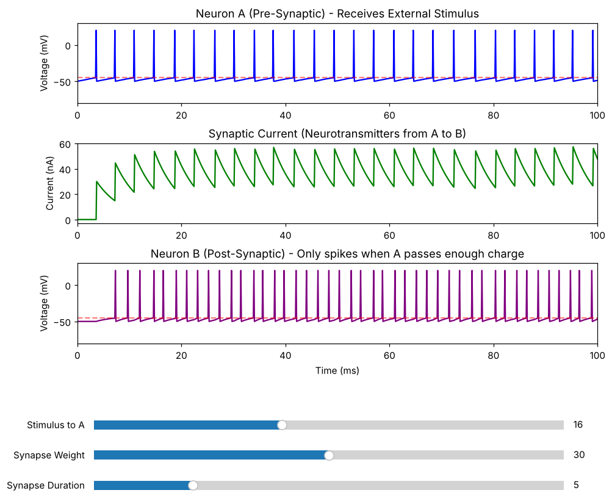

# Exp_Neuromorphic

Two spiking neurons talking to each other, with sliders.

A small, readable simulation of the Leaky Integrate-and-Fire (LIF) neuron, the model behind neuromorphic chips like Intel Loihi, IBM TrueNorth and SpiNNaker. Neuron A gets a steady stimulus; every spike it fires releases a pulse of synaptic current into Neuron B, which only fires when enough charge arrives in time.



## Run it

```bash
pip install -r requirements.txt
python lif_simulator.py
```

Drag the sliders to change the stimulus to A, the synapse weight and how long the synaptic current lasts, and watch B start, stop or fire in bursts.

## The model

Each neuron follows

```
dV/dt = (-(V - V_rest) + R·I) / τ_m
```

and resets to `V_reset` when `V` crosses `V_th`. Defaults: `τ_m` = 10 ms, `V_rest` = −50 mV, `V_th` = −45 mV, simulated for 100 ms at a 0.1 ms step. The synapse is an exponentially decaying current kicked up by each spike of A.

The neuron steps one time step at a time, rather than solving a whole array at once, so more neurons can be wired together later.
